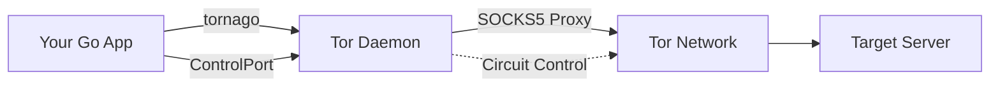
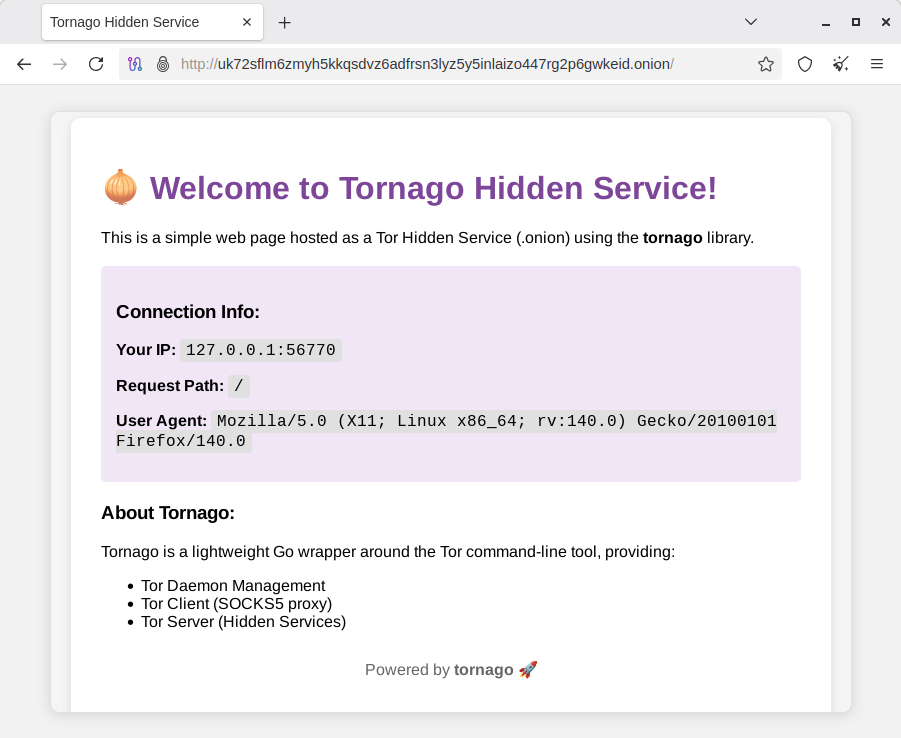

<!-- ALL-CONTRIBUTORS-BADGE:START - Do not remove or modify this section -->
[](#contributors-)
<!-- ALL-CONTRIBUTORS-BADGE:END -->
[](https://github.com/nao1215/tornago/actions/workflows/unit_test.yml)

[](https://github.com/nao1215/tornago/actions/workflows/gitleaks.yml)
[](https://github.com/nao1215/tornago/actions/workflows/trivy.yml)
[](https://github.com/nao1215/tornago/actions/workflows/govulncheck.yml)
[](https://github.com/nao1215/tornago/actions/workflows/gosec.yml)
[](https://github.com/nao1215/tornago/actions/workflows/reviewdog.yml)
[](https://pkg.go.dev/github.com/nao1215/tornago)
[](./LICENSE)
[](https://scorecard.dev/viewer/?uri=github.com/nao1215/tornago)

[日本語](./doc/ja/README.md) | [Español](./doc/es/README.md) | [Français](./doc/fr/README.md) | [한국어](./doc/ko/README.md) | [Русский](./doc/ru/README.md) | [中文](./doc/zh-cn/README.md)

# tornago


Tornago is a thin Go wrapper around the [Tor](https://www.torproject.org/) command-line tool. It can:

- launch and manage Tor daemons from Go,
- route HTTP and TCP traffic through Tor's SOCKS5 proxy, with automatic retries,
- create and remove Hidden Services (onion services) through Tor's ControlPort.

You can launch a throwaway Tor instance during development or connect to an existing Tor deployment in production. It is tested on Linux, macOS, Windows and the major BSDs.

I work on an anti-fraud team, and wrote tornago when I needed to crawl the dark web for credit card fraud prevention. Python is the usual choice for Tor crawling, but I wanted Go for production. To limit misuse, tornago stays a thin wrapper over the Tor binary and deliberately has few convenience features.

> [!IMPORTANT]
> This library is intended for legitimate purposes only, such as privacy protection, security research, and authorized fraud prevention. You are responsible for making sure your use of Tor and this library complies with the laws that apply to you. Do not use it for illegal activities.

## Features

- No Go dependencies outside the standard library; the only external dependency is the Tor binary.
- Interfaces compatible with `net.Listener`, `net.Addr` and `net.Dialer`.
- Configuration through functional options.
- Structured errors that work with `errors.Is` and `errors.As`.
- Automatic retry with exponential backoff.
- Optional metrics collection and rate limiting.

## How tornago talks to Tor

Tor sends traffic through three relays (guard, middle, exit), each of which removes one layer of encryption, so no single relay sees both your IP and your destination. The exit relay can read traffic that is not encrypted end to end, so use HTTPS. The three hops also make requests slower than a direct connection. The [Tor Project documentation](https://support.torproject.org/) explains the rest.

Tornago sends your HTTP/TCP traffic to Tor's SOCKS5 proxy, rotates circuits (to get a new exit node) through the ControlPort, and manages .onion addresses with the ADD_ONION and DEL_ONION commands:



## Requirements

- Go 1.24 or later.
- Linux, macOS, Windows, FreeBSD, OpenBSD, NetBSD or DragonFly BSD (all tested in GitHub Actions).
- The Tor daemon. Tornago is tested with Tor 0.4.8.x and should work with newer versions.

Install Tor with your package manager:

```bash
# Ubuntu/Debian
sudo apt update
sudo apt install tor

# Fedora/RHEL
sudo dnf install tor

# Arch Linux
sudo pacman -S tor

# macOS (Homebrew)
brew install tor
```

After installation, verify Tor is available:

```bash
tor --version
```

Tornago uses SOCKS5 and the following parts of the ControlPort protocol:

- ControlPort commands: AUTHENTICATE, GETINFO, SIGNAL NEWNYM, ADD_ONION, DEL_ONION
- Cookie and password authentication
- ED25519-V3 onion addresses

## Quick start

### Fetch a website through Tor

This starts a Tor daemon and fetches a page through it ([`examples/simple_client/main.go`](examples/simple_client/main.go)):

```go
package main

import (
	"context"
	"fmt"
	"io"
	"log"
	"net/http"
	"time"

	"github.com/nao1215/tornago"
)

func main() {
	// Step 1: Launch Tor daemon
	fmt.Println("Starting Tor daemon...")
	launchCfg, err := tornago.NewTorLaunchConfig(
		tornago.WithTorSocksAddr(":0"),     // Use random available port
		tornago.WithTorControlAddr(":0"),   // Use random available port
		tornago.WithTorStartupTimeout(60*time.Second),
	)
	if err != nil {
		log.Fatalf("Failed to create launch config: %v", err)
	}

	torProcess, err := tornago.StartTorDaemon(launchCfg)
	if err != nil {
		log.Fatalf("Failed to start Tor daemon: %v", err)
	}
	defer torProcess.Stop()

	fmt.Printf("Tor daemon started successfully!\n")
	fmt.Printf("  SOCKS address: %s\n", torProcess.SocksAddr())
	fmt.Printf("  Control address: %s\n", torProcess.ControlAddr())

	// Step 2: Create Tor client
	clientCfg, err := tornago.NewClientConfig(
		tornago.WithClientSocksAddr(torProcess.SocksAddr()),
		tornago.WithClientRequestTimeout(60*time.Second),
	)
	if err != nil {
		log.Fatalf("Failed to create client config: %v", err)
	}

	client, err := tornago.NewClient(clientCfg)
	if err != nil {
		log.Fatalf("Failed to create client: %v", err)
	}
	defer client.Close()

	// Step 3: Make HTTP request through Tor
	fmt.Println("\nFetching https://example.com through Tor...")
	req, err := http.NewRequestWithContext(context.Background(), http.MethodGet, "https://example.com", http.NoBody)
	if err != nil {
		log.Fatalf("Failed to create request: %v", err)
	}

	resp, err := client.Do(req)
	if err != nil {
		log.Fatalf("Request failed: %v", err)
	}
	defer resp.Body.Close()

	fmt.Printf("Status: %s\n", resp.Status)

	body, err := io.ReadAll(io.LimitReader(resp.Body, 500))
	if err != nil {
		log.Fatalf("Failed to read response: %v", err)
	}

	fmt.Printf("\nResponse preview (first 500 bytes):\n%s\n", string(body))
	if len(body) == 500 {
		fmt.Println("... (truncated)")
	}
}
```

Output:

```
Starting Tor daemon...
Tor daemon started successfully!
  SOCKS address: 127.0.0.1:42715
  Control address: 127.0.0.1:35199

Fetching https://example.com through Tor...
Status: 200 OK

Response preview (first 500 bytes):
<!doctype html><html lang="en"><head><title>Example Domain</title>...
... (truncated)
```

### Access a .onion site

Fetching an onion service works the same way; only the URL changes. [`examples/onion_client/main.go`](examples/onion_client/main.go) opens DuckDuckGo's onion service:

```go
	// Step 3: Access .onion site (DuckDuckGo)
	onionURL := "https://duckduckgogg42xjoc72x3sjasowoarfbgcmvfimaftt6twagswzczad.onion/"
	fmt.Printf("\nAccessing DuckDuckGo onion service: %s\n", onionURL)

	req, err := http.NewRequestWithContext(context.Background(), http.MethodGet, onionURL, http.NoBody)
	if err != nil {
		log.Fatalf("Failed to create request: %v", err)
	}

	resp, err := client.Do(req)
```

Output:

```
Starting Tor daemon...
Tor daemon started successfully!
  SOCKS address: 127.0.0.1:42369
  Control address: 127.0.0.1:46475

Accessing DuckDuckGo onion service: https://duckduckgogg42xjoc72x3sjasowoarfbgcmvfimaftt6twagswzczad.onion/
Status: 200 OK

Response preview (first 500 bytes):
<!DOCTYPE html><html lang="en-US" class=""><head><meta charSet="utf-8"...
... (truncated)
```

### Host a .onion site

[`examples/onion_server/main.go`](examples/onion_server/main.go) starts a local HTTP server on 127.0.0.1:8080 and publishes it as a Hidden Service. After launching Tor as above, it authenticates to the ControlPort and creates the service:

```go
	auth, _, err := tornago.ControlAuthFromTor(torProcess.ControlAddr(), 30*time.Second)
	if err != nil {
		log.Fatalf("Failed to get control auth: %v", err)
	}

	controlClient, err := tornago.NewControlClient(
		torProcess.ControlAddr(),
		auth,
		30*time.Second,
	)
	if err != nil {
		log.Fatalf("Failed to create control client: %v", err)
	}
	defer controlClient.Close()

	if err := controlClient.Authenticate(); err != nil {
		log.Fatalf("Failed to authenticate with Tor: %v", err)
	}

	hsCfg, err := tornago.NewHiddenServiceConfig(
		tornago.WithHiddenServicePort(80, 8080), // Map onion port 80 to local port 8080
	)
	if err != nil {
		log.Fatalf("Failed to create hidden service config: %v", err)
	}

	hs, err := controlClient.CreateHiddenService(context.Background(), hsCfg)
	if err != nil {
		log.Fatalf("Failed to create hidden service: %v", err)
	}
	defer func() {
		if err := hs.Remove(context.Background()); err != nil {
			log.Printf("Failed to delete hidden service: %v", err)
		}
	}()

	fmt.Printf("   Onion Address: http://%s\n", hs.OnionAddress())
```

Output:

```
Starting Tor daemon...
Tor daemon started successfully!
  SOCKS address: 127.0.0.1:36065
  Control address: 127.0.0.1:37285

Local HTTP server started on http://127.0.0.1:8080

Obtaining Tor control authentication...

Creating Hidden Service...

✅ Hidden Service created successfully!
   Onion Address: http://f64ekih3d23wxhdb547wfj7nornjw5nb3ehuu4do45tw2wwmuzhad3yd.onion
   Local Address: http://127.0.0.1:8080

You can access this hidden service through Tor using the onion address above.
Press Ctrl+C to stop the server...
```

Open the generated .onion address in Tor Browser or any other Tor client:



## Slow relay avoidance

With one option, the client measures the latency and success rate of the relays in each circuit and stops using slow ones.

### Basic usage

```go
// Create client with slow relay avoidance enabled
client, err := tornago.NewClient(
    tornago.WithClientSocksAddr(torProcess.SocksAddr()),
    tornago.WithClientControlAddr(torProcess.ControlAddr()),
    tornago.WithSlowRelayAvoidance(),  // Enable with defaults
)
if err != nil {
    log.Fatal(err)
}
defer client.Close()

// Make requests normally - everything is handled automatically
resp, err := client.Do(req)

// Optionally check performance statistics
stats, ok := client.RelayPerformanceStats()
if ok {
    fmt.Printf("Tracked: %d, Blocked: %d\n", stats.TrackedRelays(), stats.BlockedRelays())
}
```

### Custom thresholds

```go
// Enable with custom settings for stricter requirements
client, err := tornago.NewClient(
    tornago.WithClientSocksAddr(torProcess.SocksAddr()),
    tornago.WithClientControlAddr(torProcess.ControlAddr()),
    tornago.WithSlowRelayAvoidance(
        tornago.SlowRelayMaxLatency(3*time.Second),   // Block relays slower than 3s
        tornago.SlowRelayMinSuccessRate(0.9),         // Require 90% success rate
        tornago.SlowRelayBlockDuration(1*time.Hour),  // Block for 1 hour
        tornago.SlowRelayMinSamples(5),               // Need 5 samples before judging
        tornago.SlowRelayMonitorInterval(15*time.Second), // Check every 15s
    ),
)
```

### How it works

Each `client.Do` records the latency for every relay in the circuit. When a relay's average goes over the threshold, the client blocks it and, with AutoExclude on (the default), adds it to Tor's `ExcludeNodes` with `SETCONF`. A background monitor reads `GETINFO circuit-status`, and if the current circuit uses a blocked relay it sends `SIGNAL NEWNYM` so Tor builds a new circuit without it.

### Default thresholds

| Parameter | Default | Description |
|-----------|---------|-------------|
| MaxLatency | 5 seconds | Relays slower than this are considered "slow" |
| MinSuccessRate | 80% | Relays with lower success rate are blocked |
| BlockDuration | 30 minutes | How long slow relays remain blocked |
| MinSamples | 3 | Minimum measurements needed before evaluation |
| MonitorInterval | 30 seconds | Background check interval for circuit rotation |
| AutoExclude | true | Automatically update Tor's ExcludeNodes |

See [`examples/slow_relay_avoidance`](examples/slow_relay_avoidance/main.go) for a complete working example.

## More examples

All examples in `examples/` are tested and runnable:

- [`simple_client`](examples/simple_client/main.go) - Basic HTTP requests through Tor
- [`onion_client`](examples/onion_client/main.go) - Accessing .onion sites
- [`onion_server`](examples/onion_server/main.go) - Creating a Hidden Service
- [`existing_tor`](examples/existing_tor/main.go) - Connecting to system Tor daemon
- [`circuit_rotation`](examples/circuit_rotation/main.go) - Rotating circuits to change exit IP
- [`error_handling`](examples/error_handling/main.go) - Proper error handling patterns
- [`metrics_ratelimit`](examples/metrics_ratelimit/main.go) - Metrics collection and rate limiting
- [`persistent_onion`](examples/persistent_onion/main.go) - Hidden Service with persistent key
- [`observability`](examples/observability/main.go) - Structured logging, metrics, and health checks
- [`slow_relay_avoidance`](examples/slow_relay_avoidance/main.go) - Automatic slow relay detection and avoidance

## Tools using tornago

- [nao1215/onionlint](https://github.com/nao1215/onionlint): Tor site anonymity linter
- [nao1215/onionscan](https://github.com/nao1215/onionscan): dark web investigation tool

## Testing

| Technique | Bug class caught here |
|---|---|
| Unit and integration tests ([client_test.go](client_test.go), [client_integration_test.go](client_integration_test.go), [example_test.go](example_test.go)) | A function, or a real Tor daemon round trip, that no longer does what its test spells out |
| Property and boundary tests ([property_test.go](property_test.go)) | A SOCKS5 request that does not decode to its host and port, a statistic outside its range or out of step with the requests recorded, a port or domain length rejected or accepted at the wrong edge |
| Metamorphic tests ([property_test.go](property_test.go)) | Relay statistics that change with measurement order, a stricter threshold that frees a slow relay, a status-line parser thrown by an unknown keyword |
| Differential tests ([property_test.go](property_test.go)) | Address bytes that disagree with `net/netip`, an average latency that disagrees with the exact mean |
| Fuzzing ([fuzz_test.go](fuzz_test.go)) | A crash or a wrong parse on a malformed ControlPort reply or SOCKS5 reply, a command that a value can split in two |
| Mutation testing ([.github/workflows/mutation.yml](.github/workflows/mutation.yml)) | A test that runs a changed comparison or bound without noticing the change |

How to run each one is in [doc/testing.md](doc/testing.md).

## Contributing

Contributions are welcome. See the [Contributing Guide](./CONTRIBUTING.md). If tornago is useful to you, a star or [sponsorship](https://github.com/sponsors/nao1215) helps.

## Contributors ✨

Thanks goes to these wonderful people ([emoji key](https://allcontributors.org/en/reference/emoji-key/)):

<!-- ALL-CONTRIBUTORS-LIST:START - Do not remove or modify this section -->
<!-- prettier-ignore-start -->
<!-- markdownlint-disable -->
<table>
  <tbody>
    <tr>
      <td align="center" valign="top" width="14.28%"><a href="https://debimate.jp/"><br /><sub><b>CHIKAMATSU Naohiro</b></sub></a><br /><a href="https://github.com/nao1215/tornago/commits?author=nao1215" title="Code">💻</a> <a href="https://github.com/nao1215/tornago/commits?author=nao1215" title="Documentation">📖</a></td>
    </tr>
  </tbody>
</table>

<!-- markdownlint-restore -->
<!-- prettier-ignore-end -->

<!-- ALL-CONTRIBUTORS-LIST:END -->

This project follows the [all-contributors](https://github.com/all-contributors/all-contributors) specification. Contributions of any kind welcome!

## License

[MIT License](./LICENSE)

## Alternative libraries and official references

- [cretz/bine](https://github.com/cretz/bine): Go library for accessing and embedding Tor clients and servers.
- [wybiral/torgo](https://github.com/wybiral/torgo): Go library for interacting with Tor over the standard controller interface.
- [torproject/stem](https://github.com/torproject/stem): Python controller library for Tor
- [Tor Official Wiki](https://gitlab.torproject.org/tpo/team/-/wikis/home)
