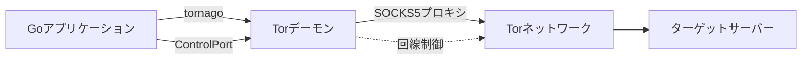

<!-- ALL-CONTRIBUTORS-BADGE:START - Do not remove or modify this section -->
[](../../README.md#contributors-)
<!-- ALL-CONTRIBUTORS-BADGE:END -->
[](https://github.com/nao1215/tornago/actions/workflows/unit_test.yml)

[](https://github.com/nao1215/tornago/actions/workflows/gitleaks.yml)
[](https://github.com/nao1215/tornago/actions/workflows/trivy.yml)
[](https://github.com/nao1215/tornago/actions/workflows/govulncheck.yml)
[](https://github.com/nao1215/tornago/actions/workflows/gosec.yml)
[](https://github.com/nao1215/tornago/actions/workflows/reviewdog.yml)
[](https://pkg.go.dev/github.com/nao1215/tornago)
[](../../LICENSE)
[](https://scorecard.dev/viewer/?uri=github.com/nao1215/tornago)

[English](../../README.md) | [Español](../es/README.md) | [Français](../fr/README.md) | [한국어](../ko/README.md) | [Русский](../ru/README.md) | [中文](../zh-cn/README.md)

# tornago


Tornagoは、[Tor](https://www.torproject.org/)コマンドラインツールの軽量ラッパーで、3つの主要機能を提供します：

- **Torデーモン管理**: Torプロセスをプログラムで起動・管理
- **Torクライアント**: HTTP/TCPトラフィックをTorのSOCKS5プロキシ経由で自動リトライ付きでルーティング
- **Torサーバー**: Tor ControlPort経由でHidden Service（オニオンサービス）を作成・管理

このライブラリは、開発環境（一時的なTorインスタンスの起動）と本番環境（既存のTorデプロイメントへの接続）の両方に対応しています。Linux、macOS、Windows、および主要なBSD系OSで動作確認済みです。

## なぜtornagoを作ったのか？

クレジットカード不正検知の文脈でダークウェブクローリングの必要性を知り、tornagoを作成しました（私は不正対策チームに所属しています）。Torベースのクローリングには一般的にPythonが使われますが、本番環境での安定性と堅牢性からGoを好むため、Go用のライブラリが欲しかったのです。

悪用を防ぐため、tornagoは意図的にTorコマンドラインツールの薄いラッパーとして設計されています。利便性機能は意図的に制限し、悪用リスクを最小化しています。

> [!IMPORTANT]
> **法的通知**: このライブラリは、プライバシー保護、セキュリティ研究、認可された不正防止活動など、合法的な目的のみを対象としています。ユーザーは、Torおよびこのライブラリの使用に適用されるすべての法律と規制に準拠していることを確認する責任があります。違法な活動にこのツールを使用しないでください。

## 機能

- Go外部依存ゼロ。標準ライブラリのみで構築
- `net.Listener`、`net.Addr`、`net.Dialer`互換インターフェースで簡単統合
- Functional Optionsパターンによる設定
- `errors.Is`/`errors.As`対応の構造化エラー
- 指数バックオフによる自動リトライ
- オプションのメトリクス収集とレート制限
- 外部依存はTorバイナリのみ

## Torの仕組み

Tor（The Onion Router）は、複数の暗号化層を経由してトラフィックをルーティングすることで匿名性を提供します。この仕組みを理解することで、tornagoを効果的に使用できます。

通信はガード、中継、出口の 3 つのリレーを通り、各リレーが暗号化を 1 層ずつ外すので、送信元 IP と宛先の両方を知るリレーはありません。出口リレーはエンドツーエンドで暗号化されていない通信を読めるため、HTTPS を使ってください。3 ホップを経由するぶん、直接接続より遅くなります。詳しくは [Tor Project のドキュメント](https://support.torproject.org/) を参照してください。

### Tornagoの役割

Tornagoは以下を処理してTor統合を簡素化します：

1. **SOCKS5プロキシ通信**: HTTP/TCPトラフィックをTorのSOCKS5プロキシ経由で自動ルーティング
2. **回線管理**: ControlPortを使用して回線をローテーション（新しい出口ノードを取得）
3. **Hidden Service作成**: ADD_ONION/DEL_ONIONコマンド経由で.onionアドレスを管理



## 要件

### Go

- **Goバージョン**: 1.25以降

### オペレーティングシステム（GitHub Actionsでテスト済み）

- Linux
- macOS
- Windows
- FreeBSD
- OpenBSD
- NetBSD
- DragonFly BSD

### Tor

TornagoはシステムにインストールされたTorデーモンを必要とします。Torバージョン0.4.8.xでテストされており、新しいバージョンでも動作します。

**インストール:**

```bash
# Ubuntu/Debian
sudo apt update
sudo apt install tor

# Fedora/RHEL
sudo dnf install tor

# Arch Linux
sudo pacman -S tor

# macOS (Homebrew)
brew install tor
```

インストール後、Torが利用可能か確認：

```bash
tor --version
```

**Torプロトコルバージョン**: TornagoはTor ControlPortプロトコルを使用し、SOCKS5プロキシ（バージョン5）をサポートします。以下をサポートするTorプロトコルバージョンと互換性があります：
- ControlPortコマンド: AUTHENTICATE, GETINFO, SIGNAL NEWNYM, ADD_ONION, DEL_ONION
- クッキーおよびパスワード認証方式
- ED25519-V3オニオンアドレス

## クイックスタート

### tornagoを使用してウェブサイトにアクセス

この例では、Torデーモンを起動し、Torを通じてウェブサイトを取得する方法を示します（`examples/simple_client/main.go`）：

```go
package main

import (
	"context"
	"fmt"
	"io"
	"log"
	"net/http"
	"time"

	"github.com/nao1215/tornago"
)

func main() {
	// Step 1: Launch Tor daemon
	fmt.Println("Starting Tor daemon...")
	launchCfg, err := tornago.NewTorLaunchConfig(
		tornago.WithTorSocksAddr(":0"),   // Use random available port
		tornago.WithTorControlAddr(":0"), // Use random available port
		tornago.WithTorStartupTimeout(60*time.Second),
	)
	if err != nil {
		log.Fatalf("Failed to create launch config: %v", err)
	}

	torProcess, err := tornago.StartTorDaemon(launchCfg)
	if err != nil {
		log.Fatalf("Failed to start Tor daemon: %v", err)
	}
	defer torProcess.Stop()

	fmt.Printf("Tor daemon started successfully!\n")
	fmt.Printf("  SOCKS address: %s\n", torProcess.SocksAddr())
	fmt.Printf("  Control address: %s\n", torProcess.ControlAddr())

	// Step 2: Create Tor client
	clientCfg, err := tornago.NewClientConfig(
		tornago.WithClientSocksAddr(torProcess.SocksAddr()),
		tornago.WithClientRequestTimeout(60*time.Second),
	)
	if err != nil {
		log.Fatalf("Failed to create client config: %v", err)
	}

	client, err := tornago.NewClient(clientCfg)
	if err != nil {
		log.Fatalf("Failed to create client: %v", err)
	}
	defer client.Close()

	// Step 3: Make HTTP request through Tor
	fmt.Println("\nFetching https://example.com through Tor...")
	req, err := http.NewRequestWithContext(context.Background(), http.MethodGet, "https://example.com", http.NoBody)
	if err != nil {
		log.Fatalf("Failed to create request: %v", err)
	}

	resp, err := client.Do(req)
	if err != nil {
		log.Fatalf("Request failed: %v", err)
	}
	defer resp.Body.Close()

	fmt.Printf("Status: %s\n", resp.Status)

	body, err := io.ReadAll(io.LimitReader(resp.Body, 500))
	if err != nil {
		log.Fatalf("Failed to read response: %v", err)
	}

	fmt.Printf("\nResponse preview (first 500 bytes):\n%s\n", string(body))
	if len(body) == 500 {
		fmt.Println("... (truncated)")
	}
}
```

**出力:**
```
Starting Tor daemon...
Tor daemon started successfully!
  SOCKS address: 127.0.0.1:42715
  Control address: 127.0.0.1:35199

Fetching https://example.com through Tor...
Status: 200 OK

Response preview (first 500 bytes):
<!doctype html><html lang="en"><head><title>Example Domain</title>...
... (truncated)
```

## 遅いリレー回避

Tornagoには、遅いTorリレーを自動的に検出して回避するパフォーマンス追跡システムが含まれています。1つのオプションで有効にするだけで、クライアントが内部ですべてを処理します。

### 基本的な使い方（推奨）

```go
// Create client with slow relay avoidance enabled
clientCfg, err := tornago.NewClientConfig(
	tornago.WithClientSocksAddr(torProcess.SocksAddr()),
	tornago.WithClientControlAddr(torProcess.ControlAddr()),
	tornago.WithSlowRelayAvoidance(), // Enable with defaults
)
if err != nil {
	log.Fatal(err)
}

client, err := tornago.NewClient(clientCfg)
if err != nil {
	log.Fatal(err)
}
defer client.Close()

// Make requests normally; everything is handled automatically
resp, err := client.Do(req)
if err != nil {
	log.Fatal(err)
}
defer resp.Body.Close()

// Optionally check performance statistics
stats, ok := client.RelayPerformanceStats()
if ok {
	fmt.Printf("Tracked: %d, Blocked: %d\n", stats.TrackedRelays(), stats.BlockedRelays())
}
```

### カスタムしきい値設定

```go
// Enable with custom settings for stricter requirements
clientCfg, err := tornago.NewClientConfig(
	tornago.WithClientSocksAddr(torProcess.SocksAddr()),
	tornago.WithClientControlAddr(torProcess.ControlAddr()),
	tornago.WithSlowRelayAvoidance(
		tornago.SlowRelayMaxLatency(3*time.Second),       // Block relays slower than 3s
		tornago.SlowRelayMinSuccessRate(0.9),             // Require 90% success rate
		tornago.SlowRelayBlockDuration(1*time.Hour),      // Block for 1 hour
		tornago.SlowRelayMinSamples(5),                   // Need 5 samples before judging
		tornago.SlowRelayMonitorInterval(15*time.Second), // Check every 15s
	),
)
if err != nil {
	log.Fatal(err)
}

client, err := tornago.NewClient(clientCfg)
if err != nil {
	log.Fatal(err)
}
defer client.Close()
```

### 動作の仕組み

`client.Do` のたびに、回線上の各リレーのレイテンシを記録します。平均がしきい値を超えたリレーはブロックし、AutoExclude が有効 (既定) なら `SETCONF` で Tor の `ExcludeNodes` に加えます。バックグラウンドの監視は `GETINFO circuit-status` を読み、今の回線がブロック済みのリレーを使っていれば `SIGNAL NEWNYM` を送って、そのリレーを含まない回線を Tor に作らせます。

### デフォルトのしきい値

| パラメータ | デフォルト | 説明 |
|-----------|---------|-------------|
| MaxLatency | 5秒 | これより遅いリレーは「遅い」とみなされます |
| MinSuccessRate | 80% | 成功率がこれより低いリレーはブロックされます |
| BlockDuration | 30分 | 遅いリレーがブロックされる期間 |
| MinSamples | 3 | 評価前に必要な最小計測回数 |
| MonitorInterval | 30秒 | 回線ローテーションのバックグラウンドチェック間隔 |
| AutoExclude | true | TorのExcludeNodesを自動更新 |

完全な動作例は[`examples/slow_relay_avoidance`](../../examples/slow_relay_avoidance/main.go)を参照してください。

## その他の例

`examples/`ディレクトリには追加の動作例があります：

- [`simple_client`](../../examples/simple_client/main.go) - Tor経由の基本的なHTTPリクエスト
- [`onion_client`](../../examples/onion_client/main.go) - .onionサイトへのアクセス
- [`onion_server`](../../examples/onion_server/main.go) - Hidden Serviceの作成
- [`existing_tor`](../../examples/existing_tor/main.go) - システムTorデーモンへの接続
- [`circuit_rotation`](../../examples/circuit_rotation/main.go) - 回線ローテーションで出口IPを変更
- [`error_handling`](../../examples/error_handling/main.go) - 適切なエラーハンドリングパターン
- [`metrics_ratelimit`](../../examples/metrics_ratelimit/main.go) - メトリクス収集とレート制限
- [`persistent_onion`](../../examples/persistent_onion/main.go) - 永続鍵を使用したHidden Service
- [`observability`](../../examples/observability/main.go) - 構造化ロギング、メトリクス、ヘルスチェック
- [`slow_relay_avoidance`](../../examples/slow_relay_avoidance/main.go) - 自動的な遅いリレー検出と回避

すべての例はテスト済みで、すぐに実行可能です。

## コントリビューション

コントリビューションを歓迎します。詳細は[コントリビューションガイド](../../CONTRIBUTING.md)をご覧ください。tornago が役に立ったら、スターや[スポンサー](https://github.com/sponsors/nao1215)で支援してもらえると助かります。

## ライセンス

[MITライセンス](../../LICENSE)

## 代替ライブラリ、公式リファレンス

- [cretz/bine](https://github.com/cretz/bine): Torクライアントとサーバーにアクセスおよび埋め込むためのGoライブラリ
- [wybiral/torgo](https://github.com/wybiral/torgo): 標準コントローラーインターフェース経由でTorと対話するGoライブラリ
- [torproject/stem](https://github.com/torproject/stem): Tor用Pythonコントローラーライブラリ
- [Tor公式Wiki](https://gitlab.torproject.org/tpo/team/-/wikis/home)
